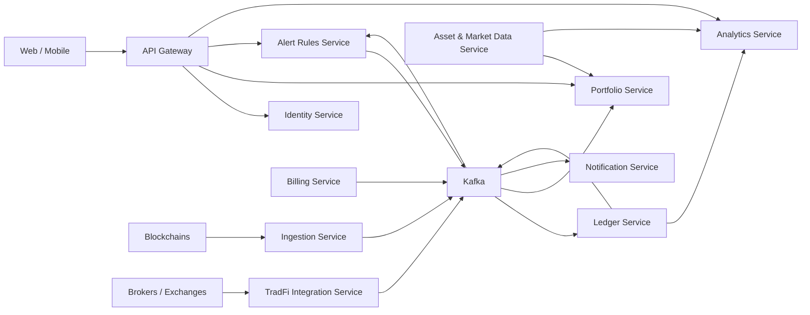

# Arquitetura do ChainTracker

## 1. Objetivo

O ChainTracker monitora wallets, contas em corretoras e contas TradFi, normaliza suas movimentações em um livro financeiro único, calcula posições e rentabilidade e envia alertas ao usuário.

Este documento assume a seguinte base tecnológica:

- Java 21
- Spring Boot
- Maven
- PostgreSQL
- Apache Kafka
- Redis
- Keycloak como provedor de identidade no MVP
- Docker para desenvolvimento local

As versões das dependências devem ser controladas pelo Spring Boot e pelo Spring Cloud BOM. Elas foram omitidas propositalmente.

## 2. Princípios arquiteturais

- Cada serviço é responsável por seu próprio domínio e seus próprios dados.
- Um serviço não acessa diretamente o banco de outro serviço.
- Consultas imediatas usam HTTP; mudanças de estado são propagadas preferencialmente por eventos Kafka.
- Todo consumidor de eventos deve ser idempotente.
- Eventos recebidos das blockchains e instituições são preservados em formato bruto para reprocessamento e auditoria.
- O Ledger é a fonte confiável do histórico financeiro.
- O Portfolio é uma projeção consultável do estado atual e pode ser reconstruído a partir do Ledger.
- Valores monetários usam `BigDecimal`, nunca `double` ou `float`.
- Datas de eventos são armazenadas em UTC.
- Segredos, tokens de corretoras e credenciais nunca aparecem em eventos ou logs.

## 3. Visão geral

## 4. Microserviços

### 4.1 API Gateway

Responsabilidades:

- ser a entrada única para web e mobile;
- validar tokens;
- encaminhar chamadas aos serviços internos;
- aplicar CORS, rate limit, correlação de requisições e limites de payload;
- agregar respostas apenas quando isso simplificar o frontend.

Dependências entre serviços:

- Identity Service ou JWKS do Keycloak
- Portfolio Service
- Alert Rules Service
- Analytics Service
- Billing Service para limites do plano, futuramente

Dependências Maven:

- spring-cloud-starter-gateway-server-webflux
- spring-boot-starter-security
- spring-boot-starter-oauth2-resource-server
- spring-boot-starter-data-redis-reactive
- spring-boot-starter-actuator
- micrometer-registry-prometheus
- resilience4j-spring-boot3
- spring-boot-starter-test
- reactor-test

O Gateway não possui banco de dados próprio.

### 4.2 Identity Service

Responsabilidades:

- armazenar perfil e preferências do usuário;
- relacionar o identificador externo do Keycloak ao usuário interno;
- manter configurações de idioma, moeda-base e fuso horário;
- futuramente, administrar organizações e membros.

No MVP, autenticação, recuperação de senha, MFA e emissão de tokens ficam no Keycloak. Não é recomendado implementar senhas e emissão de tokens do zero.

Dependências entre serviços:

- Keycloak

Dependências Maven:

- spring-boot-starter-web
- spring-boot-starter-validation
- spring-boot-starter-security
- spring-boot-starter-oauth2-resource-server
- spring-boot-starter-data-jpa
- postgresql
- flyway-core
- flyway-database-postgresql
- spring-boot-starter-actuator
- micrometer-registry-prometheus
- mapstruct
- lombok
- springdoc-openapi-starter-webmvc-ui
- spring-boot-starter-test
- spring-security-test
- testcontainers-junit-jupiter
- testcontainers-postgresql

Banco próprio: `identity_db`.

### 4.3 Portfolio Service

Responsabilidades:

- criar e editar portfólios;
- registrar wallets e contas monitoradas;
- manter watchlists e posições manuais;
- manter a projeção dos saldos atuais;
- apresentar composição do portfólio por ativo, classe, rede e moeda.

Dependências entre serviços:

- Identity Service, pelo identificador do usuário
- Asset & Market Data Service
- eventos do Ledger Service
- eventos do Billing Service para aplicação de limites

Dependências Maven:

- spring-boot-starter-web
- spring-boot-starter-validation
- spring-boot-starter-security
- spring-boot-starter-oauth2-resource-server
- spring-boot-starter-data-jpa
- spring-boot-starter-kafka
- spring-boot-starter-cache
- spring-boot-starter-data-redis
- postgresql
- flyway-core
- flyway-database-postgresql
- spring-boot-starter-actuator
- micrometer-registry-prometheus
- mapstruct
- lombok
- springdoc-openapi-starter-webmvc-ui
- spring-boot-starter-test
- spring-security-test
- testcontainers-junit-jupiter
- testcontainers-postgresql
- testcontainers-kafka

Banco próprio: `portfolio_db`.

### 4.4 Ingestion Service

Responsabilidades:

- monitorar endereços registrados;
- receber webhooks e consultar RPCs ou indexadores;
- controlar checkpoints por rede e endereço;
- persistir o payload bruto recebido;
- detectar duplicidade e acompanhar confirmações;
- tratar reorganizações de blockchain;
- publicar atividades brutas sem aplicar regras contábeis.

Os conectores devem ser módulos internos, por exemplo `evm-connector` e `solana-connector`. No início, não é necessário implantar um microserviço para cada blockchain.

Dependências entre serviços:

- eventos do Portfolio Service com wallets adicionadas ou removidas
- provedores RPC, indexadores e APIs de blockchain
- Apache Kafka

Dependências Maven:

- spring-boot-starter-webflux
- spring-boot-starter-validation
- spring-boot-starter-data-jpa
- spring-boot-starter-kafka
- spring-boot-starter-actuator
- micrometer-registry-prometheus
- resilience4j-spring-boot3
- web3j-core
- postgresql
- flyway-core
- flyway-database-postgresql
- mapstruct
- lombok
- spring-boot-starter-test
- reactor-test
- testcontainers-junit-jupiter
- testcontainers-postgresql
- testcontainers-kafka

Banco próprio: `ingestion_db`, contendo checkpoints, deduplicação e payloads brutos.

### 4.5 Ledger Service

Responsabilidades:

- converter atividades brutas em lançamentos padronizados;
- classificar depósitos, saques, swaps, compras, vendas, taxas, staking e dividendos;
- manter o histórico financeiro imutável;
- criar estornos e compensações sem apagar lançamentos anteriores;
- reconciliar lançamentos com saldos observados;
- publicar mudanças que atualizam Portfolio, Alerts e Analytics.

Dependências entre serviços:

- eventos do Ingestion Service
- eventos do TradFi Integration Service
- Asset & Market Data Service para metadados de ativos
- Apache Kafka

Dependências Maven:

- spring-boot-starter-web
- spring-boot-starter-validation
- spring-boot-starter-data-jpa
- spring-boot-starter-kafka
- spring-boot-starter-cache
- spring-boot-starter-data-redis
- postgresql
- flyway-core
- flyway-database-postgresql
- spring-boot-starter-actuator
- micrometer-registry-prometheus
- mapstruct
- lombok
- springdoc-openapi-starter-webmvc-ui
- spring-boot-starter-test
- testcontainers-junit-jupiter
- testcontainers-postgresql
- testcontainers-kafka

Banco próprio: `ledger_db`.

### 4.6 Asset & Market Data Service

Responsabilidades:

- manter o catálogo canônico de criptoativos e ativos TradFi;
- mapear contratos, redes, símbolos, casas decimais e identificadores de provedores;
- coletar preços atuais e históricos;
- coletar taxas de câmbio;
- responder avaliações em determinada moeda e instante.

Dependências entre serviços:

- provedores externos de preços e metadados
- Apache Kafka para publicar atualizações relevantes de preço

Dependências Maven:

- spring-boot-starter-web
- spring-boot-starter-webflux
- spring-boot-starter-validation
- spring-boot-starter-data-jpa
- spring-boot-starter-kafka
- spring-boot-starter-cache
- spring-boot-starter-data-redis
- postgresql
- flyway-core
- flyway-database-postgresql
- spring-boot-starter-actuator
- micrometer-registry-prometheus
- resilience4j-spring-boot3
- mapstruct
- lombok
- springdoc-openapi-starter-webmvc-ui
- spring-boot-starter-test
- reactor-test
- testcontainers-junit-jupiter
- testcontainers-postgresql
- testcontainers-kafka

Banco próprio: `market_data_db`; Redis armazena preços consultados com frequência.

### 4.7 Alert Rules Service

Responsabilidades:

- criar e editar regras de alerta;
- avaliar eventos financeiros e de preço;
- controlar cooldown, agrupamento e prevenção de spam;
- gerar uma ocorrência de alerta explicando qual regra foi satisfeita.

Exemplos de regras:

- qualquer movimentação de uma wallet;
- movimentação acima de determinado valor;
- recebimento de um ativo específico;
- interação com contrato específico;
- mudança de preço ou de valor total do portfólio.

Dependências entre serviços:

- eventos do Ledger Service
- eventos do Asset & Market Data Service
- eventos do Portfolio Service
- eventos do Billing Service para limites do plano
- Apache Kafka

Dependências Maven:

- spring-boot-starter-web
- spring-boot-starter-validation
- spring-boot-starter-security
- spring-boot-starter-oauth2-resource-server
- spring-boot-starter-data-jpa
- spring-boot-starter-kafka
- spring-boot-starter-data-redis
- postgresql
- flyway-core
- flyway-database-postgresql
- spring-boot-starter-actuator
- micrometer-registry-prometheus
- mapstruct
- lombok
- springdoc-openapi-starter-webmvc-ui
- spring-boot-starter-test
- spring-security-test
- testcontainers-junit-jupiter
- testcontainers-postgresql
- testcontainers-kafka

Banco próprio: `alerts_db`.

### 4.8 Notification Service

Responsabilidades:

- consumir ocorrências de alerta;
- renderizar mensagens por canal;
- enviar e-mail, push, webhook e integrações de mensageria;
- respeitar preferências e horários silenciosos;
- controlar tentativas, backoff, dead-letter e status de entrega.

Dependências entre serviços:

- eventos do Alert Rules Service
- Identity Service para preferências e destinos, ou uma cópia local projetada por eventos
- provedores externos de entrega
- Apache Kafka

Dependências Maven:

- spring-boot-starter-webflux
- spring-boot-starter-validation
- spring-boot-starter-data-jpa
- spring-boot-starter-kafka
- spring-boot-starter-mail
- thymeleaf-spring6
- postgresql
- flyway-core
- flyway-database-postgresql
- spring-boot-starter-actuator
- micrometer-registry-prometheus
- resilience4j-spring-boot3
- mapstruct
- lombok
- spring-boot-starter-test
- reactor-test
- testcontainers-junit-jupiter
- testcontainers-postgresql
- testcontainers-kafka

Banco próprio: `notification_db`.

### 4.9 Analytics Service

Responsabilidades:

- calcular patrimônio ao longo do tempo;
- calcular P&L realizado e não realizado;
- calcular rentabilidade e custo médio;
- calcular alocação e exposição;
- comparar o portfólio com benchmarks;
- produzir séries históricas e snapshots para dashboards.

Dependências entre serviços:

- eventos do Ledger Service
- Asset & Market Data Service
- eventos do Portfolio Service
- Apache Kafka

Dependências Maven:

- spring-boot-starter-web
- spring-boot-starter-validation
- spring-boot-starter-security
- spring-boot-starter-oauth2-resource-server
- spring-boot-starter-data-jpa
- spring-boot-starter-kafka
- spring-boot-starter-cache
- spring-boot-starter-data-redis
- postgresql
- flyway-core
- flyway-database-postgresql
- spring-boot-starter-actuator
- micrometer-registry-prometheus
- mapstruct
- lombok
- springdoc-openapi-starter-webmvc-ui
- spring-boot-starter-test
- testcontainers-junit-jupiter
- testcontainers-postgresql
- testcontainers-kafka

Banco próprio no início: `analytics_db`. ClickHouse pode substituir ou complementar o PostgreSQL quando o volume justificar.

### 4.10 TradFi Integration Service

Responsabilidades:

- conectar brokers, bancos e corretoras centralizadas;
- executar OAuth quando suportado;
- armazenar tokens externos criptografados;
- sincronizar posições, ordens executadas, taxas, dividendos e eventos corporativos;
- converter respostas externas em atividades brutas para o Ledger.

Dependências entre serviços:

- eventos do Portfolio Service com contas adicionadas ou removidas
- APIs de brokers, bancos e exchanges
- Apache Kafka

Dependências Maven:

- spring-boot-starter-web
- spring-boot-starter-webflux
- spring-boot-starter-validation
- spring-boot-starter-security
- spring-boot-starter-oauth2-client
- spring-boot-starter-data-jpa
- spring-boot-starter-kafka
- postgresql
- flyway-core
- flyway-database-postgresql
- spring-boot-starter-actuator
- micrometer-registry-prometheus
- resilience4j-spring-boot3
- mapstruct
- lombok
- springdoc-openapi-starter-webmvc-ui
- spring-boot-starter-test
- reactor-test
- testcontainers-junit-jupiter
- testcontainers-postgresql
- testcontainers-kafka

Banco próprio: `tradfi_integration_db`.

### 4.11 Billing Service

Responsabilidades:

- manter planos e assinaturas;
- processar webhooks do provedor de pagamento;
- controlar entitlements e limites de uso;
- publicar mudanças de plano para os demais serviços;
- manter histórico de cobrança sem armazenar dados completos de cartão.

Dependências entre serviços:

- Identity Service
- provedor externo de pagamentos
- eventos de uso do Portfolio e Alert Rules Service
- Apache Kafka

Dependências Maven:

- spring-boot-starter-web
- spring-boot-starter-webflux
- spring-boot-starter-validation
- spring-boot-starter-security
- spring-boot-starter-oauth2-resource-server
- spring-boot-starter-data-jpa
- spring-boot-starter-kafka
- postgresql
- flyway-core
- flyway-database-postgresql
- spring-boot-starter-actuator
- micrometer-registry-prometheus
- resilience4j-spring-boot3
- mapstruct
- lombok
- springdoc-openapi-starter-webmvc-ui
- spring-boot-starter-test
- spring-security-test
- reactor-test
- testcontainers-junit-jupiter
- testcontainers-postgresql
- testcontainers-kafka

Banco próprio: `billing_db`.

## 5. Eventos principais

Nomes sugeridos para eventos de domínio:

- `UserProfileCreated`
- `PortfolioCreated`
- `WalletTrackingRequested`
- `WalletTrackingStopped`
- `RawActivityDetected`
- `RawActivityConfirmed`
- `RawActivityReverted`
- `LedgerEntryCreated`
- `LedgerEntryReversed`
- `PortfolioPositionUpdated`
- `MarketPriceUpdated`
- `AlertTriggered`
- `NotificationDeliveryRequested`
- `NotificationDelivered`
- `NotificationFailed`
- `TradFiActivityDetected`
- `SubscriptionEntitlementUpdated`

Todo evento deve conter pelo menos:

- `eventId`
- `eventType`
- `eventVersion`
- `occurredAt`
- `correlationId`
- `producer`
- identificador do agregado relacionado

Alterações que atualizam banco e publicam eventos devem usar o padrão Transactional Outbox. Consumidores registram os `eventId` já processados para garantir idempotência.

## 6. Ordem recomendada de desenvolvimento

### Etapa 0 — Fundação técnica

Criar antes dos domínios:

- repositório ou estrutura de múltiplos repositórios;
- convenções de API e eventos;
- Docker Compose com PostgreSQL, Kafka, Redis e Keycloak;
- observabilidade, correlação de logs e health checks;
- pipeline de testes e build;
- biblioteca mínima de contratos de eventos, evitando compartilhar entidades de domínio.

Entrega: ambiente local reproduzível e um serviço de exemplo publicando e consumindo um evento.

### Etapa 1 — Identity Service

Criar perfis associados ao Keycloak e definir o identificador global de usuário.

Entrega: usuário autenticado consegue consultar e atualizar o próprio perfil.

### Etapa 2 — Portfolio Service

Permitir criar portfólio e cadastrar uma wallet, inicialmente somente leitura.

Entrega: usuário autenticado cadastra uma wallet EVM e visualiza seu estado de monitoramento.

### Etapa 3 — Ingestion Service

Implementar apenas uma família de rede no primeiro corte, preferencialmente EVM. Começar com transferências nativas e de ERC-20, confirmações, checkpoints e deduplicação.

Entrega: uma transação da wallet cadastrada produz `RawActivityDetected` uma única vez.

### Etapa 4 — Ledger Service

Normalizar as atividades EVM, registrar lançamentos e tratar reversões. Esta etapa fecha a primeira trilha de dados confiável.

Entrega: uma atividade confirmada gera lançamentos auditáveis e reconstruíveis.

### Etapa 5 — Asset & Market Data Service

Cadastrar ativos encontrados pelo Ledger e integrar um provedor de preços. Adicionar moeda-base e histórico básico.

Entrega: os lançamentos e saldos podem ser avaliados em USD e BRL.

### Etapa 6 — Projeção de saldos no Portfolio

Fazer o Portfolio consumir eventos do Ledger e do Market Data, mantendo posições atuais sem consultar seus bancos diretamente.

Entrega: dashboard básico com ativos, quantidades e valor total.

### Etapa 7 — Alert Rules e Notification

No MVP, eles podem nascer no mesmo projeto implantável e ser separados quando os ciclos de escala ou manutenção divergirem. Começar com alerta de qualquer movimentação e entrega por e-mail e dentro do app.

Entrega: uma transação confirmada dispara uma única notificação, com retry seguro.

### Etapa 8 — API Gateway

Colocar o Gateway diante dos serviços depois que as primeiras APIs estiverem estáveis. Configurar autenticação, rotas, CORS, rate limit e observabilidade.

Entrega: o frontend acessa todos os recursos públicos por uma URL única.

### Etapa 9 — Analytics Service

Começar por snapshots de patrimônio e P&L simples. Adicionar custo médio, P&L realizado e benchmarks depois que as regras contábeis estiverem validadas.

Entrega: gráfico histórico e visão de rentabilidade reproduzíveis a partir do Ledger.

### Etapa 10 — TradFi Integration Service

Adicionar um único provedor de cada vez. Reutilizar o mesmo contrato de atividade bruta consumido pelo Ledger, sem criar um segundo modelo financeiro.

Entrega: posições e movimentações TradFi aparecem no mesmo portfólio das wallets.

### Etapa 11 — Billing Service

Adicionar somente quando planos e limites estiverem definidos e o produto precisar monetizar.

Entrega: assinatura controla limites de wallets, alertas e sincronizações.

## 7. Corte de implantação para o MVP

Embora os limites de domínio acima devam existir no código, começar com onze aplicações aumenta muito o custo operacional. O primeiro MVP pode usar seis unidades implantáveis:

1. `gateway-identity`
2. `portfolio`
3. `ingestion`
4. `ledger`
5. `market-data`
6. `alerts-notifications`

Inicialmente:

- Analytics pode ser um módulo do Portfolio.
- TradFi pode começar como conectores do Ingestion.
- Billing pode ficar fora do primeiro MVP.
- Os módulos devem respeitar os limites de domínio para permitir extração posterior.

Um serviço deve ser separado fisicamente quando houver necessidade concreta de escala independente, isolamento de falhas, segurança, propriedade por equipe ou ciclo de implantação diferente.

## 8. Primeiro fluxo vertical recomendado

O primeiro marco funcional deve implementar o caminho completo:

1. usuário autentica;
2. usuário cria um portfólio;
3. usuário adiciona uma wallet EVM;
4. Ingestion detecta uma transferência nativa ou ERC-20;
5. Ledger normaliza e registra a movimentação;
6. Portfolio atualiza a posição;
7. Market Data calcula o valor em BRL ou USD;
8. Alert Rules cria um alerta;
9. Notification entrega o aviso;
10. frontend mostra a transação e o saldo atualizado.

Esse fluxo valida a arquitetura de ponta a ponta antes da adição de outras redes, DeFi, NFTs, brokers ou regras analíticas avançadas.

## 9. Referências técnicas

- [Spring Boot](https://docs.spring.io/spring-boot/reference/)
- [Spring Cloud Gateway](https://docs.spring.io/spring-cloud-gateway/reference/)
- [Spring for Apache Kafka](https://docs.spring.io/spring-kafka/reference/)
- [Spring Security OAuth 2.0](https://docs.spring.io/spring-security/reference/servlet/oauth2/)
- [Flyway](https://documentation.red-gate.com/flyway)

