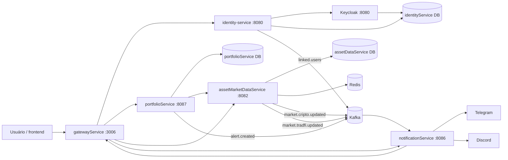

# ChainTracker

Repositório de **orquestração local** do ecossistema ChainTracker. Ele reúne o `docker-compose.yaml`, as exportações do realm do Keycloak, o exemplo de variáveis de ambiente e a licença do projeto. Não há código de aplicação aqui: cada microsserviço vive em seu próprio repositório e é construído a partir do diretório indicado no compose.

---

## Visão geral

O ChainTracker é uma plataforma de acompanhamento de portfólios de criptomoedas e ações. O ambiente local sobe, em uma única rede Docker:

- cinco aplicações Spring Boot;
- quatro bancos PostgreSQL independentes;
- um broker Kafka em modo KRaft;
- um Kafka UI;
- um Keycloak com realm importado;
- um Redis compartilhado.

O objetivo do repositório é permitir que todo o ecossistema seja executado com um único `docker compose up`.

---

## Arquitetura do ecossistema



Todos os containers conversam pela rede `chaintracker-network`, usando o **nome do serviço** como hostname (por exemplo, `http://identity-service:8080`).

---

## Serviços do compose

| Serviço | Build | Portas host → container | Depende de | Variáveis principais |
|---|---|---|---|---|
| `identity-service` | `./identity-service` | `3002:8080` | `identity-service-db` | `KEYCLOAK_SECRET` |
| `notification-service` | `./notificationService` | `3005:8086` | `notification-service-db` | `NOTIFICATION_CLIENT_SECRET`, `TELEGRAM_KEY`, `DISCORD_TOKEN`, `DISCORD_WEBHOOK_URL` |
| `portfolio-service` | `./portfolioService` | `3004:8087` | `portfolio-service-db` | — |
| `assetmarketdata-service` | `./assetMarketDataService` | `3003:8082` | `assetData-service-db` | `COINGECKO_KEY`, `ALPACA_KEY`, `ALPACA_SECRET` |
| `gateway` | `./gatewayService` | `3006:3006` | `keycloak` (healthy) | `SERVER_PORT=3006` |
| `identity-service-db` | `postgres:17` | `5432:5432` | — | `POSTGRES_USER`, `POSTGRES_PASSWORD` |
| `assetData-service-db` | `postgres:17` | `5433:5432` | — | `POSTGRES_USER`, `POSTGRES_PASSWORD` |
| `portfolio-service-db` | `postgres:17` | `5434:5432` | — | `POSTGRES_USER`, `POSTGRES_PASSWORD` |
| `notification-service-db` | `postgres:17` | `5435:5432` | — | `POSTGRES_USER`, `POSTGRES_PASSWORD` |
| `kafka` | `apache/kafka:4.3.1` | `9092:9092` | — | configuração KRaft |
| `kafka-ui` | `ghcr.io/kafbat/kafka-ui:v1.5.0` | `8083:8080` | `kafka` | `KAFKA_CLUSTERS_0_*` |
| `keycloak` | `quay.io/keycloak/keycloak:latest` | `8081:8080` | `identity-service-db` | `KC_*`, `POSTGRES_*` |
| `redis` | `redis:latest` | `6379:6379` | — | `REDIS_PASSWORD` |

> Os caminhos de build são relativos ao arquivo `docker-compose.yaml` e usam os nomes `identity-service`, `notificationService`, `portfolioService`, `assetMarketDataService` e `gatewayService`. Mantenha os repositórios nesses caminhos ao subir o stack ou ajuste os `build` no compose.

### Bancos de dados

O compose cria quatro instâncias PostgreSQL 17. Cada serviço usa o banco do próprio domínio:

| Container | Banco | Usuário do banco | Porta no host |
|---|---|---|---|
| `identity-service-db` | `identityService` | `POSTGRES_USER` | 5432 |
| `assetData-service-db` | `assetDataService` | `POSTGRES_USER` | 5433 |
| `portfolio-service-db` | `portfolioService` | `POSTGRES_USER` | 5434 |
| `notification-service-db` | `notificationService` | `POSTGRES_USER` | 5435 |

O banco `identityService` também é usado pelo Keycloak para persistir o realm, usuários, clients e sessões.

### Kafka

O broker roda em modo **KRaft** (broker e controller no mesmo nó), com:

- listener interno em `kafka:29092`;
- listener externo em `kafka:9092`;
- `KAFKA_AUTO_CREATE_TOPICS_ENABLE=true`;
- replication factor 1 e uma partição por tópico — configuração adequada para desenvolvimento local;
- volume `kafka-data` para persistência.

Tópicos usados pelo ecossistema:

| Tópico | Produtor | Consumidor |
|---|---|---|
| `market.cripto.updated` | `assetMarketDataService` | `notificationService` |
| `market.tradfi.updated` | `assetMarketDataService` | `notificationService` |
| `alert.created` | `portfolioService` | `notificationService` |
| `linked.users` | `identity-service` | `notificationService` |

O **Kafka UI** fica disponível em `http://localhost:8083`.

### Redis

O Redis sobe com `--requirepass ${REDIS_PASSWORD}` e `--appendonly yes`. É usado por:

- `assetMarketDataService` para cache de catálogo e cotações;
- `notificationService` para o índice de alertas em sorted set (`alertas:<assetId>`).

O `portfolioService` também possui Redis configurado no `application.yaml` e um `RedisTemplate` registrado, mas o fluxo atual de consulta de mercado usa diretamente o `assetMarketDataService`.

### Keycloak

O container sobe com `start-dev --import-realm` e importa o arquivo `realm-export.json`, montado dentro do container como `ChainTracker-realm.json`.

O repositório também mantém `ChainTracker-realm.json`, uma exportação complementar do mesmo realm que inclui os clients `gateway-client`, `notification-client`, `portfolio-service` e `web-frontend`, além das roles `app-user` e `app-service`.

#### Clients do realm

| Client | Tipo | Uso |
|---|---|---|
| `identity-service` | confidencial, service account e direct access | admin client do `identity-service` e login por usuário/senha |
| `gateway-client` | confidencial, authorization code | login OAuth2 pelo `gatewayService` |
| `notification-client` | confidencial, service account, client credentials | chamadas do `notificationService` ao gateway com escopo `bot` |
| `portfolio-service` | confidencial, service account | integrações internas do `portfolioService` |
| `web-frontend` | público, authorization code | frontend web |
| `account`, `account-console`, `admin-cli`, `broker`, `realm-management`, `security-admin-console` | clients padrão do Keycloak | administração e recursos nativos |

#### Roles do realm

| Role | Finalidade |
|---|---|
| `app-user` | usuário final da aplicação |
| `app-service` | identidade de serviço |
| `default-roles-chaintracker` | role composta padrão do realm |

A console administrativa do Keycloak fica em `http://localhost:8081/admin`, usando as credenciais `KC_BOOTSTRAP_ADMIN_USERNAME` e `KC_BOOTSTRAP_ADMIN_PASSWORD`.

---

## Volumes e rede

### Rede

Todos os serviços entram na rede bridge `chaintracker-network`.

### Volumes nomeados

| Volume | Conteúdo |
|---|---|
| `identityService` | dados do PostgreSQL do identity-service e do Keycloak |
| `assetDataService` | dados do PostgreSQL do assetMarketDataService |
| `portfolioService` | dados do PostgreSQL do portfolioService |
| `notificationService` | dados do PostgreSQL do notificationService |
| `kafka-data` | dados do broker Kafka |
| `redis-data` | dados do Redis (AOF) |

Os volumes persistem entre reinícios. Para apagar os dados locais, use `docker compose down -v`.

---

## Variáveis de ambiente

O arquivo `.env.example` serve de modelo para o `.env`:

| Variável | Usada por | Descrição |
|---|---|---|
| `POSTGRES_USER` | bancos PostgreSQL e Keycloak | usuário dos bancos |
| `POSTGRES_PASSWORD` | bancos PostgreSQL e Keycloak | senha dos bancos |
| `KC_BOOTSTRAP_ADMIN_USERNAME` | Keycloak | usuário administrador inicial |
| `KC_BOOTSTRAP_ADMIN_PASSWORD` | Keycloak | senha do administrador inicial |
| `REDIS_PASSWORD` | Redis | senha do Redis |
| `KEYCLOAK_SECRET` | `identity-service` | secret do client `identity-service` |
| `NOTIFICATION_CLIENT_SECRET` | `notification-service` | secret do client `notification-client` |
| `TELEGRAM_KEY` | `notification-service` | token do bot do Telegram |
| `DISCORD_TOKEN` | `notification-service` | token do bot do Discord |
| `DISCORD_WEBHOOK_URL` | `notification-service` | webhook usado para enviar alertas ao Discord |
| `COINGECKO_KEY` | `assetMarketDataService` | chave da API da CoinGecko |
| `ALPACA_KEY` | `assetMarketDataService` | chave da API da Alpaca |
| `ALPACA_SECRET` | `assetMarketDataService` | secret da API da Alpaca |

O compose usa a sintaxe `${VARIAVEL:?defina VARIAVEL no .env}` para as variáveis obrigatórias: se alguma estiver ausente, o Compose interrompe a subida com uma mensagem explícita.

---

## Como subir o ambiente

### Pré-requisitos

- Docker Engine ou Docker Desktop com Compose v2;
- os repositórios dos cinco serviços disponíveis nos caminhos de build usados pelo compose;
- acesso às APIs externas da CoinGecko e da Alpaca;
- token de um bot do Telegram e token/webhook de um bot do Discord.

### Passo a passo

```bash
# 1. entre no repositório de orquestração
cd ChainTracker

# 2. crie o arquivo de ambiente
cp .env.example .env

# 3. preencha os valores reais no .env

# 4. suba todo o stack
docker compose up --build -d

# 5. acompanhe a inicialização
docker compose ps
docker compose logs -f gateway
```

Na primeira subida, o Compose:

1. cria a rede e os volumes;
2. sobe os quatro PostgreSQL;
3. sobe Kafka, Kafka UI e Redis;
4. sobe o Keycloak e importa o realm;
5. aguarda o Keycloak ficar saudável;
6. constrói e sobe os cinco serviços Spring Boot.

### Pontos de acesso

| Recurso | URL |
|---|---|
| Gateway (entrada principal) | `http://localhost:3006` |
| identity-service | `http://localhost:3002` |
| assetMarketDataService | `http://localhost:3003` |
| portfolioService | `http://localhost:3004` |
| notificationService | `http://localhost:3005` |
| Keycloak | `http://localhost:8081` |
| Console do Keycloak | `http://localhost:8081/admin` |
| Kafka UI | `http://localhost:8083` |
| PostgreSQL identity | `localhost:5432` |
| PostgreSQL asset | `localhost:5433` |
| PostgreSQL portfolio | `localhost:5434` |
| PostgreSQL notification | `localhost:5435` |
| Redis | `localhost:6379` |

### Documentação OpenAPI

Cada serviço com API HTTP gera sua própria especificação OpenAPI e publica um Swagger UI. O gateway também oferece um Swagger UI agregado, com um seletor para alternar entre os serviços.

| Recurso | URL |
|---|---|
| Swagger UI agregado (gateway) | `http://localhost:3006/swagger-ui.html` |
| Swagger UI do identity-service | `http://localhost:3002/swagger-ui.html` |
| Swagger UI do assetMarketDataService | `http://localhost:3003/swagger-ui.html` |
| Swagger UI do portfolioService | `http://localhost:3004/swagger-ui.html` |

As especificações JSON individuais ficam em `/v3/api-docs` na porta de cada serviço. No Swagger UI agregado, o gateway as expõe em:

| Serviço | Caminho pelo gateway |
|---|---|
| `assetMarketDataService` | `http://localhost:3006/docs/asset/v3/api-docs` |
| `identity-service` | `http://localhost:3006/docs/identity/v3/api-docs` |
| `portfolioService` | `http://localhost:3006/docs/portfolio/v3/api-docs` |

O `notificationService` não participa da agregação porque é orientado a eventos e não expõe controllers HTTP de negócio.

### Comandos úteis

```bash
# status dos containers
docker compose ps

# logs de um serviço específico
docker compose logs -f portfolio-service

# reconstruir apenas um serviço
docker compose up --build -d portfolio-service

# parar o stack preservando os volumes
docker compose down

# parar o stack e apagar os dados locais
docker compose down -v
```

---

## Estrutura do repositório

```text
ChainTracker/
├── .env.example            # modelo das variáveis de ambiente
├── ChainTracker-realm.json # exportação complementar do realm
├── LICENSE                 # licença MIT
├── README.md
├── docker-compose.yaml     # orquestração de todos os serviços
└── realm-export.json       # realm importado pelo Keycloak no compose
```

---

## Licença

Este repositório está licenciado sob a **MIT License**. Consulte o arquivo `LICENSE` para os termos completos.
